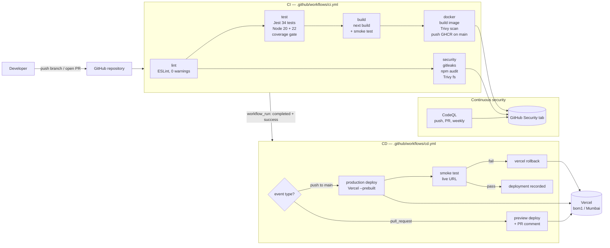

# CI/CD Pipeline — FoodShare

This document describes the continuous integration and continuous delivery
pipeline that ships the FoodShare Next.js application. Everything here is
implemented in the repository: `.github/workflows/`, `Dockerfile`,
`docker-compose.yml`, `jest.config.js`, `.eslintrc.json`, `vercel.json` and
`scripts/`.

---

## 1. Objectives

| Goal | How the pipeline meets it |
| --- | --- |
| Catch defects before merge | Lint + unit tests + coverage gate on every pull request |
| Never ship a broken build | Production build and a route-level smoke test run in CI |
| Ship fast after merge | CD deploys the exact commit CI validated, with no manual build step |
| Fail safe | Post-deploy smoke test triggers an automatic rollback |
| Secure by default | Secret scanning, dependency audit, Trivy (filesystem + image), CodeQL, SARIF into the Security tab |
| Reproducible | Lockfile-based installs, Node version pinned in `.nvmrc`, container image built from a multi-stage Dockerfile |
| Auditable | Job summaries, build artifacts, coverage artifacts, deployment URLs recorded per run |

---

## 2. Architecture



Two rules make the design safe:

1. **CD never runs on its own.** It is triggered by `workflow_run` on the CI
   workflow and only proceeds when CI concluded `success`. The commit that is
   deployed is the commit CI tested (`head_sha`), not whatever is on the branch
   at deploy time.
2. **A deployment is not "done" until it answers HTTP 200.** The smoke test
   hits every public route on the live URL; a failure rolls production back.

---

## 3. Toolchain

| Tool | Role in the pipeline | Why this choice |
| --- | --- | --- |
| GitHub Actions | CI/CD orchestration | Native to the repository, free minutes for public repos, huge action ecosystem |
| ESLint (`eslint-config-next`) | Static analysis / style gate | Catches unused imports, bad React patterns, accessibility and Next-specific mistakes |
| Jest + React Testing Library | Unit and component tests | Fast, no browser needed, works with the Next.js SWC transform via `next/jest` |
| Vercel (CLI, `--prebuilt`) | Hosting and delivery | Zero-ops PaaS: preview per PR, atomic production releases, instant rollback |
| Docker (multi-stage) | Reproducible image | Same artifact locally and in any container host; keeps the option to move to ECS/Kubernetes |
| GHCR | Container registry | Built into GitHub, authenticated with `GITHUB_TOKEN` (no extra secret) |
| Trivy | Container + filesystem vulnerability scan | Free, produces SARIF, understands OS packages and npm libraries |
| gitleaks | Secret scanning | Blocks accidental commits of tokens/keys |
| CodeQL | SAST | Data-flow analysis of the JavaScript/TypeScript code, results in the Security tab |
| Dependabot | Dependency + action updates | Weekly grouped PRs; each one runs the full pipeline before merge |

---

## 4. Stages

### 4.1 CI — `.github/workflows/ci.yml`

Triggers: `pull_request` and `push` to `main` / `develop`.
Concurrency group cancels superseded runs on the same ref.

| # | Job | Depends on | What it does | Blocks merge |
| --- | --- | --- | --- | --- |
| 1 | `lint` | — | `npm ci`, `next lint --max-warnings=0` | Yes |
| 2 | `test` | `lint` | `jest --ci --coverage` on Node 20 **and** 22 (matrix), coverage thresholds in `jest.config.js`, coverage table in the job summary, `coverage/` uploaded as an artifact | Yes |
| 3 | `build` | `test` | `next build`, then `node scripts/smoke-test.mjs` boots the production build and asserts `/`, `/auth`, `/donate`, `/donor`, `/ngo`, `/donation/1` all return 200; `.next/` uploaded as an artifact | Yes |
| 4 | `security` | `lint` | gitleaks secret scan; `npm audit` report in the summary; Trivy filesystem scan uploaded as SARIF | gitleaks: yes. Audits: report-only (see §7) |
| 5 | `docker` | `build` | Buildx build with GitHub Actions layer cache, Trivy image scan (SARIF), push to `ghcr.io/<repo>/foodshare` on `main` only | Image must build; push is `main`-only |
| 6 | `ci-summary` | all above | Single required status check: fails if any of lint/test/build/docker did not succeed | Yes |

### 4.2 CD — `.github/workflows/cd.yml`

Triggered by `workflow_run` (CI completed).

| Job | Condition | Steps |
| --- | --- | --- |
| `preview` | CI succeeded and the run came from a `pull_request` | checkout tested SHA → `vercel pull --environment=preview` → `vercel build` → `vercel deploy` → smoke test the preview URL → comment the URL on the PR |
| `production` | CI succeeded and the run came from a `push` to `main` | checkout tested SHA → `vercel pull --environment=production` → `vercel build --prod` → `vercel deploy --prebuilt --prod` → smoke test the live URL → **rollback on failure** |

Both jobs declare a GitHub **Environment** (`preview`, `production`), so
`production` can require a manual approval and hold its own secrets.

### 4.3 Supporting workflows

| File | Trigger | Purpose |
| --- | --- | --- |
| `.github/workflows/codeql.yml` | push/PR to `main`, weekly cron | CodeQL analysis (`security-and-quality` queries) |
| `.github/workflows/rollback.yml` | manual (`workflow_dispatch`) | One-click production rollback, with the reason recorded in the run summary |
| `.github/dependabot.yml` | weekly | Grouped npm, GitHub Actions and Docker base-image updates |

---

## 5. Environments and secrets

Repository → Settings → Secrets and variables → Actions:

| Secret | Where it comes from | Used by |
| --- | --- | --- |
| `VERCEL_TOKEN` | Vercel → Account Settings → Tokens | CD (pull/build/deploy/rollback) |
| `VERCEL_ORG_ID` | `.vercel/project.json` after `vercel link`, or Vercel → Team settings | CD |
| `VERCEL_PROJECT_ID` | `.vercel/project.json` after `vercel link` | CD |
| `GITLEAKS_LICENSE` | gitleaks.io — **only required for organization-owned repos**; personal repos work without it | CI `security` |
| `GITHUB_TOKEN` | Automatic | GHCR push, PR comments, SARIF upload |

`GITHUB_TOKEN` is created by Actions; never add it manually. No other secret is
needed — the pipeline runs with the minimum permissions declared per job
(`contents: read`, `packages: write`, `security-events: write`).

---

## 6. Quality gates

Measured on the current codebase (`npm run test:ci`):

| Gate | Threshold | Actual |
| --- | --- | --- |
| ESLint | 0 warnings | 0 |
| Test suites | all pass | 7 suites / 34 tests |
| Coverage — `lib/` | 85% statements, 90% lines | 87.5% / 95.8% |
| Coverage — `components/` | 80% statements, 80% lines | 82.9% / 82.9% |
| Production build | must succeed | succeeds (8 routes) |
| Smoke test | all 6 routes 200 | passes |

The thresholds live in `jest.config.js` (`coverageThreshold`). Raise them as
page-level tests are added; never lower them to get a green build.

---

## 7. Security posture and accepted risks

The security job runs four independent checks. Three are gates, one is a
report:

- **gitleaks** — blocks the build. A leaked credential is never acceptable.
- **CodeQL** — blocks via the branch-protection rule on the code-scanning
  result; findings appear in Security → Code scanning.
- **Trivy (filesystem + image)** — reports with `exit-code: 0`, findings are
  uploaded as SARIF and triaged. Blocking on every CRITICAL would make the
  pipeline red on day one for issues with no available fix.
- **npm audit** — report-only. `next@14.2.35` still carries advisories whose
  only fix is the Next.js 16 major upgrade (a framework migration, not a patch).
  This is a known, documented risk: the app ships with the latest 14.2.x patch,
  the advisories are visible in the job summary on every run, and Dependabot
  opens the upgrade PR. Treat "zero audit findings" as the goal, not a
  precondition for shipping this version.

Other hardening already in the pipeline: `npm ci` from the lockfile (no floating
versions), non-root user in the runtime image, `.dockerignore` keeps `.env*` and
`.git` out of the image, security headers in `next.config.js`, and the Vercel
deployment is immutable — a rollback re-points the alias, it does not rebuild.

---

## 8. Rollback

Three layers, in order of speed:

1. **Automatic** — if the post-deploy smoke test fails, `cd.yml` runs
   `vercel rollback --yes` and fails the job. Production is back on the previous
   deployment within seconds.
2. **Manual, one click** — Actions → *Rollback* → *Run workflow*, optionally
   pasting the deployment URL to return to.
3. **Manual, CLI** — `vercel rollback <deployment-url>` with a Vercel token.

---

## 9. Reproducing the pipeline locally

Every CI step can be run on a laptop; the order mirrors the pipeline:

```bash
npm ci                     # 1. clean, lockfile-exact install
npm run lint:ci            # 2. ESLint, zero warnings
npm run test:ci            # 3. Jest + coverage gate
npm run build              # 4. production build
npm run smoke              # 5. boot the build, assert every route is 200
docker compose up --build  # 6. the exact container image CI builds
```

`BASE_URL=https://your-deployment.vercel.app npm run smoke` runs the same smoke
test against a live deployment — that is what the CD workflow does.

---

## 10. Branch protection (one-time, on GitHub)

Settings → Branches → protect `main`:

- Require a pull request before merging (1 approval).
- Require status checks: `Lint`, `Test (Node 20)`, `Test (Node 22)`,
  `Build + smoke test`, `Docker image`, `CI result`.
- Require branches to be up to date before merging.
- Require linear history; block force pushes.
- (Optional) Require the `production` environment to be approved by a reviewer.

---

## 11. Troubleshooting

| Symptom | Cause | Fix |
| --- | --- | --- |
| `npm ci` fails with "lock file out of sync" | `package.json` edited without re-running install | `npm install` locally and commit `package-lock.json` |
| `Error: No existing credentials found` in CD | `VERCEL_TOKEN` missing/expired | Regenerate the token, update the secret |
| `vercel pull` fails with "project not found" | `VERCEL_ORG_ID` / `VERCEL_PROJECT_ID` wrong or from another team | Re-run `vercel link` and copy both ids |
| gitleaks exits non-zero on a personal repo | It found a real secret, or a license is required for an org repo | Rotate the secret, add `GITLEAKS_LICENSE` |
| Smoke test 401 on a preview URL | Vercel Deployment Protection | Add the Vercel protection-bypass header to the smoke test, or disable protection for previews |
| Coverage threshold fails | New code without tests | Add tests; do not lower the threshold |
| Docker image builds but app 404s | `NEXT_OUTPUT=standalone` missing from the build stage | Keep `ENV NEXT_OUTPUT=standalone` in the Dockerfile builder stage |

---

## 12. Deliberate scope limits / next steps

Not included, and why:

- **End-to-end browser tests (Playwright)** — valuable, but they need a running
  server plus a browser download in CI; the route-level smoke test covers the
  "does it boot and answer" risk at a fraction of the cost.
- **Staging environment** — the current flow is PR preview → production. A
  permanent staging alias is the next step once there is a backend.
- **Kubernetes manifests** — the Docker image is ready for it, but a PaaS target
  was chosen; `docker-compose.yml` covers local/VM parity in the meantime.
- **Observability** — add Sentry (build-time DSN from a secret) and an uptime
  check on the production URL; both slot into the existing `production` job.
